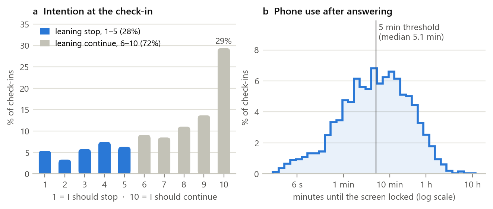
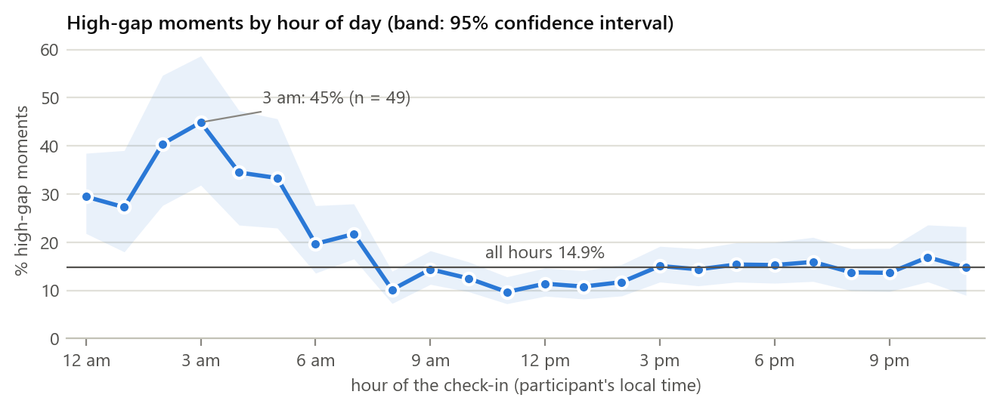
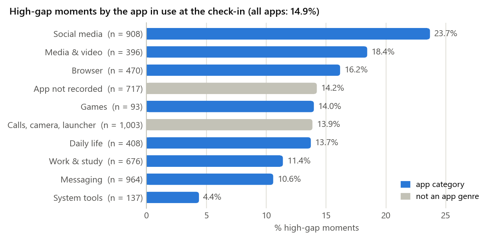
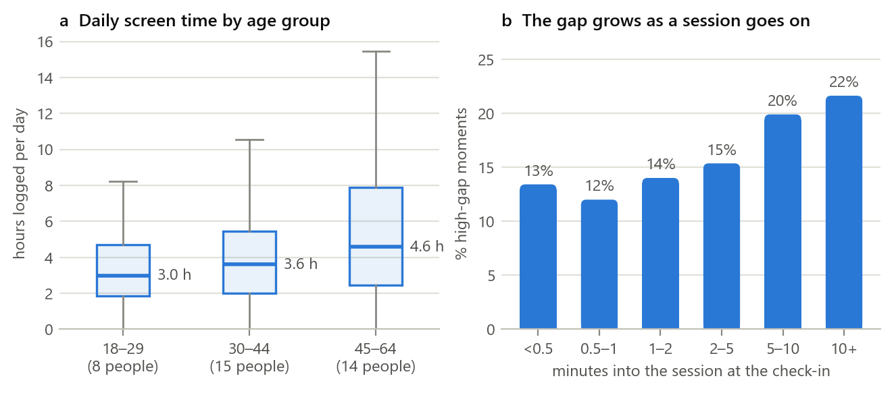
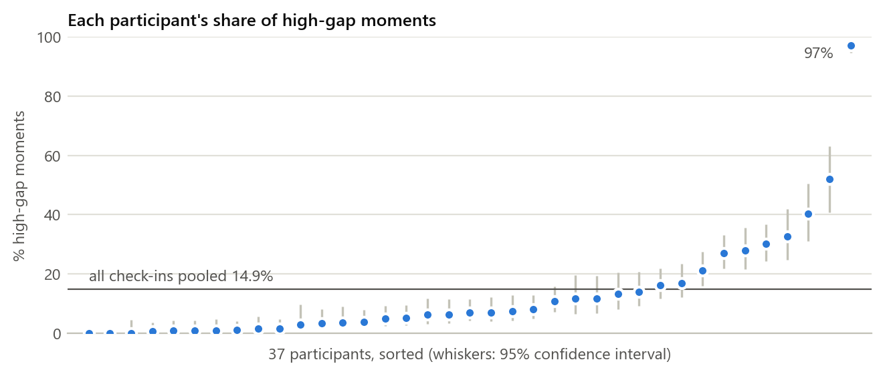

> **Summary.** NudgeWell targets problematic smartphone use at the level of a single session. It focuses on the *intention–behavior gap*: the moment a person feels they should stop using their phone but keeps going. Our target group is adults who use their phones heavily and want to cut down.
>
> **Part 1** reviews 14 studies in four themes. Existing work measures problematic use per person, detects overuse rather than unwanted use, and predicts the in-the-moment gap poorly for new users.
>
> **Part 2** analyses the AwareMind dataset (5,772 in-session check-ins from 37 adults). High-gap moments make up 14.9% of check-ins and peak at night (33.7% between midnight and 6 am). They are most common in social media (23.7%) and differ strongly between people: 44% of the variation lies between participants.
>
> **Part 3** compares the technologies needed for an opt-in Android prototype. It selects Android usage APIs, tree-based baselines alongside compact temporal and personalized models, and on-device inference.

[[TOC]]

[[PAGEBREAK]]

# Part 1: Literature Review

## 1.1 Introduction

**The problem.** Digital addiction is increasingly framed around loss of control rather than amount of use. For example, the WHO's ICD-11 definition of gaming disorder rests on three features: impaired control, increasing priority given to the behaviour, and continuation despite negative consequences (World Health Organization, n.d.). For smartphones, a meta-analysis covering 24 countries concluded that smartphone addiction is increasing worldwide (Olson et al., 2022). Problematic smartphone use is consistently associated with depression and, more weakly, with anxiety (Elhai et al., 2017). Yet total screen time is a poor marker of harm: in 10,099 US adults, objectively measured use showed weak or null associations with mood (Winbush et al., 2025).

NudgeWell therefore focuses on one specific, observable form of lost control: the **in-session intention–behavior gap (IBG)**. This is the moment when a person feels they should stop using the phone but continues anyway (Zheng & Choe, 2026). It defines "problematic use" by the user's own goal instead of an external time limit.

**Target group.** Adults who use their smartphones heavily (roughly three or more hours a day) and want to cut down. This matches our primary dataset: 37 US adults aged 18–64, recruited because they wanted to reduce their phone use (Zheng & Choe, 2026). In the Yeşilay context this group includes Turkish university students, young professionals and older working adults. Applying US findings in Turkey is a stated limitation (Section 2.6).

**Why it matters.** Problematic use is linked to depressive symptoms, stress and anxiety (Elhai et al., 2017). People describe habitual, passive use as meaningless and as reducing their sense of autonomy (Lukoff et al., 2018). Usage profiles with lower well-being are characterized by night-time sessions (Katevas et al., 2018). Sleep, mood and attention are all at stake, but the evidence points to *patterns* of use rather than raw minutes.

**Why review the literature first.** NudgeWell's design depends on choices the literature has already tested: how to define and measure the problem, which interventions people accept, which data and baselines exist, and where earlier models failed. Reviewing them first stops us from re-solving solved problems, building on invalid measures, or claiming a contribution that already exists.

## 1.2 Organization

The review is organized into four themes, following the guide's suggested structure:

1. Definitions and measurement of problematic smartphone use.
2. Prevalence, risk factors and consequences.
3. Prevention and intervention approaches.
4. AI and data-driven approaches to detection, prediction and support.

Table 1 summarizes the 14 studies reviewed in depth. Section 1.3 compares them within and across themes.

## 1.3 Summary and synthesis

Table 1. Studies reviewed, by theme (ESM = experience sampling: short in-the-moment surveys).
<!-- widths: 2.4,3.2,2.3,4.2,3.2 -->
| Study | Aim and design | Sample | Key findings | Contribution to NudgeWell |
|---|---|---|---|---|
| § Theme 1: Definitions and measurement | | | | |
| Kwon et al. (2013) | Develop and validate a 10-item short Smartphone Addiction Scale (SAS-SV); survey with ROC-based cut-offs | 540 Korean adolescents (mean age 14.5) | Cronbach's α = .911; cut-off scores of 31 (boys) and 33 (girls); correlated with longer addiction scales | Standard person-level screening tool; describes users, not moments |
| Noyan et al. (2015) | Validate the Turkish SAS-SV | 367 university students in Istanbul | α = .867; test–retest r = .926; correlated with an internet addiction scale | Validated Turkish instrument for a future Turkish pilot |
| Parry et al. (2021) | Pre-registered meta-analysis of how well self-reported media use matches logged use | 106 effect sizes | Self-reports correlate only moderately with logs and are rarely accurate; problematic-use scales match logs even less | Scales alone cannot locate problem moments; logs plus momentary reports are needed |
| Lukoff et al. (2018) | Why some smartphone use feels meaningless; interviews, ESM and app logging | 86,402 logged app sessions | Habitual use to pass time, entertainment and passive social media felt less meaningful and reduced autonomy | Supports defining problems by the user's own judgement |
| § Theme 2: Prevalence, risk factors and consequences | | | | |
| Elhai et al. (2017) | Conceptual overview and systematic review of problematic use and psychopathology | 23 studies | Depression consistently related (medium or larger effects); anxiety small; stress small to medium; all correlational | Mental-health relevance; reliance on self-report scales |
| Katevas et al. (2018) | Find phone-use profiles in logs and relate them to well-being | 340 participants, 4 weeks | Five profiles; intense use alone did not predict negative well-being; lower-well-being groups were marked by nightly use | Target specific patterns such as night-time use, not total time |
| Winbush et al. (2025) | Links over time between objectively measured use and mood | 10,099 US adults, about 250,000 days | Weak or null associations within and between people; demographics predicted mood better than use | Screen time is a poor harm signal; target unwanted use instead |
| § Theme 3: Prevention and intervention | | | | |
| Monge Roffarello & De Russis (2023) | Systematic review and meta-analysis of digital self-control tools (timers, lock-outs) | Published tool studies | Real effectiveness still poorly understood; calls for long-term studies, standard measures and a wider view than overuse | Evaluate honestly; avoid building another generic timer |
| Haliburton et al. (2024) | Long-term, real-world study of the *one sec* friction app | 1,039 users, 13.4 weeks on average | Users mostly target social media; short frictions reduce opening attempts and make openings more intentional; users take breaks and quickly rebound | Brief prompts work but engagement fades; secondary dataset |
| Xu et al. (2022) | *TypeOut*: just-in-time typing of self-affirmations when unlocking | 54 participants, 10-week within-subject field study | Cut app usage by more than 50%, and opening frequency and duration by more than 25%; beat two baselines | The content of a prompt matters, not only its timing |
| § Theme 4: AI and data-driven approaches | | | | |
| Shin & Dey (2013) | Detect problematic users automatically from usage logs (AdaBoost) | Smartphone users with self-reported labels | 89.6% accuracy (F = .707) from features such as apps used per day and event-initiated sessions | Logs can detect problematic use, but only per person |
| Suh & Yoo (2025) | Review of internet-addiction research plus a machine-learning pipeline for risk levels | Review and modelling study | Handling missing values and class imbalance clearly improved performance; physiology, activity, sleep and usage were key features | Same data-quality issues we face; person-level only |
| Orzikulova et al. (2024) | *Time2Stop*: adaptive, explainable just-in-time intervention with a human–AI feedback loop | 71 participants, 8-week field experiment | Adaptive models beat baselines on intervention accuracy (>32.8% relative) and receptivity (>8.0%); explanations added 53.8% and 11.4%; app visits fell 7.0–8.9% | Closest system design; it times interventions but does not model the user's own wish to stop |
| Zheng & Choe (2026) | Define, explain and predict the in-session gap with mixed models and random forests | 37 US adults, at least 2 weeks each, 5,772 ESM check-ins | Gap related to gender, time of day, app, interactions, activity and session length; combined global-plus-personal model reached R² = .208, model for unseen users .035 | Our primary dataset, target definition and benchmark |

### Theme 1: Definitions and measurement

The field still lacks a single definition. Clinical framings borrow the ICD-11 core of impaired control, priority and continuation despite harm (World Health Organization, n.d.). Most smartphone studies instead measure addiction with self-report scales such as the SAS-SV, which is short, reliable and validated in Turkish (Kwon et al., 2013; Noyan et al., 2015).

The weakness of scales is how well they match behaviour. Self-reported use correlates only moderately with logs, and problematic-use scales correlate even less (Parry et al., 2021). Studies that combine logs with in-the-moment reports show that the *quality* of use matters: passive and habitual use is rated as meaningless (Lukoff et al., 2018). The IBG follows this second approach. It asks people during the session what they intend, then compares that with what they actually do (Zheng & Choe, 2026).

### Theme 2: Prevalence, risk factors and consequences

Reviews agree that problematic use is common, rising and linked to poorer mental health (Busch & McCarthy, 2021; Elhai et al., 2017; Olson et al., 2022). The disagreement is about *time*. Correlations are consistent when problematic use is self-reported (Elhai et al., 2017). But large studies with objective logs find weak or null links between minutes of use and mood (Winbush et al., 2025), and intense use alone does not predict lower well-being (Katevas et al., 2018). The same log study points to *when* use happens: profiles with lower well-being are marked by night-time sessions (Katevas et al., 2018). Our own data show the same night-time peak (Section 2.5).

### Theme 3: Prevention and intervention

Lightweight, just-in-time interventions reduce unwanted use in field studies. Short frictions make app openings more intentional (Haliburton et al., 2024), and self-affirmation prompts cut usage substantially (Xu et al., 2022). The just-in-time adaptive intervention (JITAI) framework explains why: support works best when it adapts to the person's changing state and context (Nahum-Shani et al., 2018).

Two limitations recur. Effects fade or rebound when people take breaks (Haliburton et al., 2024). And evaluations are mostly short-term, with outcomes counted in minutes rather than well-being (Monge Roffarello & De Russis, 2023). Most available tools also remain generic timers and lock-outs (Lyngs et al., 2019).

### Theme 4: AI and data-driven approaches

Machine learning can detect problematic *users* from logs (Shin & Dey, 2013) or predict internet-addiction risk levels (Suh & Yoo, 2025). But these are person-level labels: they say nothing about *when* to help. *Time2Stop* moved prediction to the moment. It learned when to intervene from user feedback, and its explanations improved acceptance (Orzikulova et al., 2024).

AwareMind is the only study that predicts the IBG itself (Zheng & Choe, 2026). Across these studies, personalization helps: adaptive and personal models beat global ones. For the IBG, a global model barely generalizes to new users (R² = .035), while a model combining global and personal data reaches R² = .208.

### Comparison and limitations

The studies agree on three points:
- self-reports alone are unreliable;
- generic time limits are weak;
- timing and personalization matter.

They disagree on whether the amount of use is harmful in itself. Their limitations are also shared:
- small or convenience samples (37–71 people in the field studies);
- self-reported outcomes;
- mostly single-country samples from the US, Europe or Korea;
- short follow-up;
- outcomes measured as minutes of use rather than well-being.

## 1.4 Research gap and conclusion

**Key takeaways.**

- Problematic use is better defined by loss of control than by screen time, and the user's own judgement is a valid anchor (Lukoff et al., 2018; Zheng & Choe, 2026).
- Brief, well-timed, user-chosen interventions work, but they must adapt to the person to stay effective (Haliburton et al., 2024; Orzikulova et al., 2024; Xu et al., 2022).
- Machine learning has mainly been used to classify problematic *people* or to time generic interventions.

**The gap.**

1. **Measurement:** scales capture traits and logs capture time; only one dataset captures the momentary conflict between intention and behaviour.
2. **Prediction:** the IBG has only been modelled with random forests, and predictions for new users are close to useless. No study has tested sequence models or systematic personalization for it.
3. **Intervention:** just-in-time systems decide *when* to interrupt based on usage or receptivity, not on whether the person actually wants to stop.
4. **Population:** there is no momentary data from Turkey, or from anywhere outside the US, Europe and East Asia.

**Our contribution.** NudgeWell will:
- benchmark temporal and personalized models of the IBG against the published random forest, using leakage-safe evaluation split by participant and reporting negative results honestly;
- turn calibrated predictions into a low-burden, opt-in prompt policy: quiet by default, a daily prompt budget, and the user's own alternatives;
- build it as an Android prototype on top of the Eşik prototype from the August 2026 SIC hackathon.

In practice, it aims to reduce digital addiction by helping only at moments that users themselves would endorse.

### References (Part 1)

Busch, P. A., & McCarthy, S. (2021). Antecedents and consequences of problematic smartphone use: A systematic literature review of an emerging research area. *Computers in Human Behavior, 114*, Article 106414. https://doi.org/10.1016/j.chb.2020.106414

Elhai, J. D., Dvorak, R. D., Levine, J. C., & Hall, B. J. (2017). Problematic smartphone use: A conceptual overview and systematic review of relations with anxiety and depression psychopathology. *Journal of Affective Disorders, 207*, 251–259. https://doi.org/10.1016/j.jad.2016.08.030

Haliburton, L., Grüning, D. J., Riedel, F., Schmidt, A., & Terzimehić, N. (2024). A longitudinal in-the-wild investigation of design frictions to prevent smartphone overuse. In *Proceedings of the CHI Conference on Human Factors in Computing Systems* (pp. 1–16). ACM. https://doi.org/10.1145/3613904.3642370

Katevas, K., Arapakis, I., & Pielot, M. (2018). Typical phone use habits: Intense use does not predict negative well-being. In *Proceedings of the 20th International Conference on Human-Computer Interaction with Mobile Devices and Services* (pp. 1–13). ACM. https://doi.org/10.1145/3229434.3229441

Kwon, M., Kim, D.-J., Cho, H., & Yang, S. (2013). The Smartphone Addiction Scale: Development and validation of a short version for adolescents. *PLoS ONE, 8*(12), Article e83558. https://doi.org/10.1371/journal.pone.0083558

Lukoff, K., Yu, C., Kientz, J., & Hiniker, A. (2018). What makes smartphone use meaningful or meaningless? *Proceedings of the ACM on Interactive, Mobile, Wearable and Ubiquitous Technologies, 2*(1), 1–26. https://doi.org/10.1145/3191754

Lyngs, U., Lukoff, K., Slovak, P., Binns, R., Slack, A., Inzlicht, M., Van Kleek, M., & Shadbolt, N. (2019). Self-control in cyberspace: Applying dual systems theory to a review of digital self-control tools. In *Proceedings of the 2019 CHI Conference on Human Factors in Computing Systems* (pp. 1–18). ACM. https://doi.org/10.1145/3290605.3300361

Monge Roffarello, A., & De Russis, L. (2023). Achieving digital wellbeing through digital self-control tools: A systematic review and meta-analysis. *ACM Transactions on Computer-Human Interaction, 30*(4), 1–66. https://doi.org/10.1145/3571810

Nahum-Shani, I., Smith, S. N., Spring, B. J., Collins, L. M., Witkiewitz, K., Tewari, A., & Murphy, S. A. (2018). Just-in-time adaptive interventions (JITAIs) in mobile health: Key components and design principles for ongoing health behavior support. *Annals of Behavioral Medicine, 52*(6), 446–462. https://doi.org/10.1007/s12160-016-9830-8

Noyan, C., Darcin, A., Nurmedov, S., Yilmaz, O., & Dilbaz, N. (2015). Validity and reliability of the Turkish version of the Smartphone Addiction Scale-Short Version among university students. *Anatolian Journal of Psychiatry, 16*, 73. https://doi.org/10.5455/apd.176101

Olson, J. A., Sandra, D. A., Colucci, É. S., Al Bikaii, A., Chmoulevitch, D., Nahas, J., Raz, A., & Veissière, S. P. L. (2022). Smartphone addiction is increasing across the world: A meta-analysis of 24 countries. *Computers in Human Behavior, 129*, Article 107138. https://doi.org/10.1016/j.chb.2021.107138

Orzikulova, A., Xiao, H., Li, Z., Yan, Y., Wang, Y., Shi, Y., Ghassemi, M., Lee, S.-J., Dey, A. K., & Xu, X. (2024). Time2Stop: Adaptive and explainable human-AI loop for smartphone overuse intervention. In *Proceedings of the CHI Conference on Human Factors in Computing Systems* (pp. 1–20). ACM. https://doi.org/10.1145/3613904.3642747

Parry, D. A., Davidson, B. I., Sewall, C. J. R., Fisher, J. T., Mieczkowski, H., & Quintana, D. S. (2021). A systematic review and meta-analysis of discrepancies between logged and self-reported digital media use. *Nature Human Behaviour, 5*(11), 1535–1547. https://doi.org/10.1038/s41562-021-01117-5

Shin, C., & Dey, A. K. (2013). Automatically detecting problematic use of smartphones. In *Proceedings of the 2013 ACM International Joint Conference on Pervasive and Ubiquitous Computing* (pp. 335–344). ACM. https://doi.org/10.1145/2493432.2493443

Suh, Y., & Yoo, J. (2025). Risk level prediction for problematic internet use: A digital health perspective. *Internet Interventions, 41*, Article 100863. https://doi.org/10.1016/j.invent.2025.100863

Winbush, A., McDuff, D., Hernandez, J., Barakat, A., Jiang, A., Heneghan, C., Nelson, B. W., & Allen, N. B. (2025). Smartphone use in a large US adult population: Temporal associations between objective measures of usage and mental well-being. *Proceedings of the National Academy of Sciences, 122*(43), Article e2427311122. https://doi.org/10.1073/pnas.2427311122

World Health Organization. (n.d.). *Gaming disorder*. Retrieved October 11, 2026, from https://www.who.int/standards/classifications/frequently-asked-questions/gaming-disorder

Xu, X., Zou, T., Xiao, H., Li, Y., Wang, R., Yuan, T., Wang, Y., Shi, Y., Mankoff, J., & Dey, A. K. (2022). TypeOut: Leveraging just-in-time self-affirmation for smartphone overuse reduction. In *CHI Conference on Human Factors in Computing Systems* (pp. 1–17). ACM. https://doi.org/10.1145/3491102.3517476

Zheng, J., & Choe, E. K. (2026). *To stop or not to stop: Exploring the intention-behavior gaps in smartphone usage* (arXiv:2609.08909) [Preprint, MobileHCI 2026]. arXiv. https://doi.org/10.48550/arXiv.2609.08909

[[PAGEBREAK]]

# Part 2: Data Research

## 2.1 Introduction

The data research answers four questions that the model will depend on:

- **RQ-D1:** How common is the intention–behavior gap, and how are its two parts (stated intention and subsequent use) distributed?
- **RQ-D2:** When and where does the gap occur, in terms of time of day, app, session length and activity?
- **RQ-D3:** How person-specific is it? How much of its variation lies between people rather than within the same person?
- **RQ-D4:** Is the data fit for leakage-safe, personalized temporal modelling, in terms of coverage, ordering and quality?

A thorough exploration is necessary for three reasons. The target is constructed rather than directly observed, and several columns are derived from the outcome, so they would leak it into a model. The positive class is rare. And each person contributes many correlated observations, which determines how models must be split and evaluated.

## 2.2 Organization

- Section 2.3 describes the datasets we considered and their access conditions.
- Section 2.4 covers ethics and privacy, both for the secondary data and for our prototype under KVKK.
- Section 2.5 reports the analysis (Figures 1–5, Table 3).
- Section 2.6 lists data-quality issues and how we will handle them.
- Section 2.7 concludes.

All numbers come from our reproducible analysis notebook (`notebooks/01_awaremind_eda.ipynb`).

## 2.3 Data description

Table 2. Datasets considered.
<!-- widths: 2.3,4.5,3.6,3.6 -->
| | AwareMind (primary) | one sec (secondary) | Child Mind Institute PIU (rejected) |
|---|---|---|---|
| Source | OSF project x6yzs (Zheng & Choe, 2026a) | OSF project bmjat (Haliburton et al., 2024) | Kaggle competition (Child Mind Institute, n.d.) |
| Format and size | One CSV of 4.3 MB: 5,772 rows × 92 columns, plus data dictionaries | Logs of app-opening attempts and interventions | Tabular measures plus accelerometer (actigraphy) series |
| Time span and collection | July–October 2025; Android logging app with in-session pop-up questions; at least 2 weeks per person | 1,039 real-world users, 13.4 weeks on average | Child and adolescent assessments with wrist-worn actigraphy |
| Labels | Intention (1–10), remaining use until the screen locks, intention–behavior gap | Users' responses to the friction (no intention labels) | Severity Impairment Index (person level) |
| Role in NudgeWell | Training and evaluating the gap model | Optional intervention-response analysis only | Not used: no phone sessions, no momentary intention |
| Access and licence | Public download; **no licence attached** (checked 11 Oct 2026) | Public OSF project | Kaggle account and competition rules |

**Participants.** AwareMind contains 37 adults living in the US: 22 women and 15 men, aged 18–64 (mean 42.1, SD 13.3). All used Android as their main phone, used it at least 3 hours a day, and wanted to cut down (Zheng & Choe, 2026b). Data were collected between 2 July and 6 October 2025 across five US time zones. Each person contributed 72–294 check-ins (median 155) over 13–31 days (median 18.5).

**How it was collected.** The AwareMind app logged phone use. During some sessions it asked, "I should ___ using my phone now", answered on a scale from 1 (stop) to 10 (continue). Behaviour is the time remaining until the screen locked.

**Target.** `intention_behavior_gap` = `remaining_scaled` − `answer`. Here `remaining_scaled` is the logarithm of the remaining minutes (capped at 128 minutes, which affects 1.0% of check-ins), rescaled linearly to the answer's range. A positive gap means the person kept using the phone longer than their stated intention implied. We confirmed this definition exactly in the data. Following the paper, we also mark **high-gap moments**: an intention below 5.5 together with more than 5 further minutes of use.

**Features available before the outcome.**
- Time: hour, weekday, time of day.
- Session: time elapsed so far.
- Interactions: taps, scrolls in four directions, text edits.
- The current app's category, and app usage so far.
- Physical activity: still, walking, in a vehicle, and so on.
- Cumulative screen time that day.
- History: number and average length of earlier sessions that day, and time since the last session.
- Demographics: age, gender, education, race, employment.

**Why this dataset.** It is the only public dataset that pairs an in-the-moment statement of intention with the behaviour that followed, logged on real Android phones. It also comes with a published benchmark, which makes the project's central question testable.

**Access and licence.** The files can be downloaded publicly from OSF, but the project has no licence attached. The article's CC BY 4.0 licence covers the paper, not the data. We use the data only for coursework analysis, keep it out of public repositories, and recorded the files' checksums. We will obtain written reuse permission from the authors before model training or publication.

## 2.4 Ethics and data privacy

**Secondary data (AwareMind).** The data are pseudonymized: participants appear only as short codes (two letters and three digits). They still contain sensitive attributes: age, gender, race, employment, time zone, timestamps, and the package names of the apps in use. Our safeguards:
- keep the raw files local, out of any public or shared repository;
- report only aggregated results, and show no participant codes in figures;
- remove package names and raw timestamps from anything we share;
- make no attempt at re-identification;
- use the data only for this study's research questions.

**Our prototype under KVKK (Law No. 6698).** NudgeWell's Android prototype would process personal data, and an inferred "problematic use" state could count as health-related data. Under Article 6, as amended in 2024, data concerning health is a special category. Processing it is prohibited unless an exception applies, such as the person's explicit consent (Law No. 6698, 2016). We therefore design for:

- **Explicit, informed opt-in consent** before any processing (Art. 5), with a plain-language explanation of what is used and why.
- **Purpose limitation and data minimization** (Art. 4). We use app categories and session timing only: no message content, keystroke content or screen captures, kept only as long as needed.
- **On-device processing and storage.** No account, no sale of data, no advertising use, and appropriate technical and organizational security measures (Art. 12).
- **Data-subject rights** (Art. 11). Users can view, correct, export or delete their data, pause the app, and withdraw at any time.
- **Adults only.** Minors are outside the target group; including them would require parental consent and a separate ethics review.
- **Safety.** Crisis-related language is handled on the device and routed to fixed Yeşilay YEDAM / 115 information, never to a generated answer.

The Eşik prototype already implements on-device storage, full local deletion and a crisis-language short-circuit, which NudgeWell will reuse. Any future pilot with Turkish participants would need informed-consent forms, a KVKK information notice (*aydınlatma metni*) and institutional ethics approval.

## 2.5 Data analysis and insights

The analysis below covers the primary dataset only. The one sec data are reserved for a later, optional intervention-response analysis, and the Child Mind Institute data were rejected for this project (Table 2), so neither is analysed here.

**Insight 1: People mostly intend to continue, but the gap is a substantial minority (Figure 1).**
- 72% of check-ins leaned toward continuing, and 29.4% were a firm "10". Only 28.3% leaned toward stopping.
- Further use was heavily skewed: median 5.1 minutes, mean 15.0 minutes, 5.2% longer than an hour, and a maximum of 10.8 hours. This is why the released target is log-transformed and capped.
- **High-gap moments** (leaning toward stopping, yet using the phone for more than 5 more minutes) made up **14.9% of check-ins (859 of 5,772)**. This reproduces the paper's published figure exactly and confirms our reading of the data.

**Insight 2: The gap peaks at night (Figure 2).** Between midnight and 6 am, 33.7% of check-ins were high-gap moments (n = 395), compared with 12.6% between 9 am and 6 pm. The peak was 45% at 3 am (n = 49, with a wide confidence interval).
- By time of day, night (26.9%) clearly exceeded morning (13.3%), afternoon (12.9%) and evening (14.7%).
- Weekends (15.4%) barely differed from weekdays (14.7%).

This matches the finding that usage profiles with lower well-being are marked by night-time sessions (Katevas et al., 2018). Time of day is therefore a key feature, and it is known before the outcome.

**Insight 3: Social media carries the largest gap (Figure 3).** High-gap moments were most frequent in social media (23.7%, n = 908), media and video (18.4%) and browsers (16.2%). They were least frequent in messaging (10.6%) and system tools (4.4%). This agrees with two earlier findings: the paper's model showed larger gaps for browser, game, social and media apps than for messaging, and one sec users chose to restrict social media most often (Haliburton et al., 2024; Zheng & Choe, 2026b). The app category was missing for 12.4% of check-ins ("App not recorded").

**Insight 4: Heavy daily use, and the gap grows within a session (Figure 4).**
- **Daily use.** On the median participant-day, at least 3.7 hours of screen time were logged (n = 645 days). By age group the medians were 3.0 h (18–29), 3.6 h (30–44) and 4.6 h (45–64). These are lower bounds, because screen time is only recorded up to each day's last check-in. They confirm that the sample consists of heavy users.
- **Within a session.** The high-gap share rose with the time already spent in the session: 13.4% in the first 30 seconds, 19.9% after 5–10 minutes, and 21.6% after more than 10 minutes. Elapsed session time is therefore a useful real-time signal, and it was among the paper's most important features.

**Insight 5: The gap is strongly person-specific (Figure 5).**
- Individual high-gap shares ranged from 0% (for 3 people) to 97.2%, with a median of 7.0% and an interquartile range of 1.6–16.1%.
- The intraclass correlation (ICC) is 0.44 for the gap and 0.45 for stated intention. In other words, about 44% of the gap's variation lies between people rather than within the same person.
- This explains why one shared model generalizes poorly to new users (R² = .035 in the paper). It is the strongest argument in the data for personalization.

**Insight 6: Who, and in what context (Table 3).** These are descriptive patterns from 37 people, so each comparison rests on only a few individuals.
- **Gender.** Women (19.7%) had more than twice the high-gap share of men (8.1%).
- **Age.** The oldest group (45–64, 20.0%) had a higher share than the 18–29 (12.9%) and 30–44 (10.9%) groups. Younger participants leaned toward stopping more often, but they also stopped sooner.
- **Activity.** The gap was less frequent while walking (6.9%) than while still (15.4%).

Table 3. High-gap share by participant group and context (descriptive).
<!-- widths: 3.0,2.0,1.6,2.4,2.4,2.8 -->
| Group | Check-ins | People | High-gap moments | Mean intention (1–10) | Median further use (min) |
|---|---|---|---|---|---|
| Age 18–29 | 1,313 | 8 | 12.9% | 6.2 | 2.9 |
| Age 30–44 | 2,218 | 15 | 10.9% | 6.9 | 3.9 |
| Age 45–64 | 2,241 | 14 | 20.0% | 7.8 | 9.7 |
| Women | 3,394 | 22 | 19.7% | 6.8 | 7.5 |
| Men | 2,378 | 15 | 8.1% | 7.6 | 3.3 |
| Still (not moving) | 5,157 | 37 | 15.4% | 7.1 | 5.4 |
| Walking | 447 | 33 | 6.9% | 7.2 | 2.6 |

## 2.6 Data quality issues and how we will handle them

Table 4. Data-quality issues and handling.
<!-- widths: 2.6,5.6,5.6 -->
| Issue | Evidence | Handling |
|---|---|---|
| Missing app information | 12.4% of check-ins (717) lack the app category and app-usage fields; activity is missing for 2.3% | Keep as explicit "not recorded" or "unknown" categories with missingness flags; never drop silently |
| Class imbalance | High-gap moments are 14.9% of check-ins | Precision–recall AUC and F1, class weights and a tuned threshold; never accuracy alone |
| Self-report bias | 11 participants answered "10" to more than half of their prompts (up to 89%); the authors had already excluded 5 people who did so for over 95% | Standardize answers per person; use personal models; run a sensitivity analysis without near-constant raters |
| Skewed outcome | Further use has a median of 5.1 min and a maximum of 10.8 h | Use the released log transform with a 128-minute cap (1.0% of check-ins capped) |
| Target leakage | `answer`, the `remaining_*` columns, `lock_time` and the undocumented `temp_scaled` (a rescaled copy of the outcome) all reveal the target | Exclude these columns; build features only from data available at the check-in |
| Undocumented and duplicate columns | 9 of 92 columns are undocumented; two sets of columns are exact duplicates (session time; cumulative screen time); the gender and education codes have no published key | Audited each column; keep one of each duplicate; gender key inferred from the published counts; education not used until confirmed |
| Repeated measures | 72–294 check-ins per person; 5,549 sessions, 204 of them with more than one check-in | Leave-one-participant-out splits for new users; chronological splits within each person for personalization |
| Small, US-only sample | 37 adults in five US time zones | Bootstrap confidence intervals, per-person results, and explicit limits on transfer to Turkish users |

## 2.7 Conclusion

The data support NudgeWell's goals in four ways:

1. **The target is reproducible.** Our computation matches the published 14.9% exactly.
2. **Strong context signals are available before the outcome:** night-time, social-media use and elapsed session time.
3. **The gap is strongly person-specific** (ICC 0.44). That justifies personalized models and evaluation split by participant.
4. **The risks are known and manageable:** leakage columns, class imbalance, self-report bias and a small US-only sample.

Every check-in has a timestamp, so session histories can be ordered and the planned temporal models are feasible. The main open item is the data licence, which we will resolve with the authors before training.

### References (Part 2)

Child Mind Institute. (n.d.). *Child Mind Institute — Problematic internet use* [Competition data set]. Kaggle. Retrieved September 19, 2026, from https://www.kaggle.com/competitions/child-mind-institute-problematic-internet-use

Haliburton, L., Grüning, D. J., Riedel, F., Schmidt, A., & Terzimehić, N. (2024). A longitudinal in-the-wild investigation of design frictions to prevent smartphone overuse. In *Proceedings of the CHI Conference on Human Factors in Computing Systems* (pp. 1–16). ACM. https://doi.org/10.1145/3613904.3642370

Katevas, K., Arapakis, I., & Pielot, M. (2018). Typical phone use habits: Intense use does not predict negative well-being. In *Proceedings of the 20th International Conference on Human-Computer Interaction with Mobile Devices and Services* (pp. 1–13). ACM. https://doi.org/10.1145/3229434.3229441

Law No. 6698 on the Protection of Personal Data. (2016). *Official Gazette of the Republic of Türkiye*, No. 29677 (7 April 2016). English translation retrieved October 11, 2026, from https://www.kvkk.gov.tr/Icerik/6649/Personal-Data-Protection-Law

Zheng, J., & Choe, E. K. (2026a). *Intention-behavior gap in smartphone usage* [Data set]. OSF. https://osf.io/x6yzs/

Zheng, J., & Choe, E. K. (2026b). *To stop or not to stop: Exploring the intention-behavior gaps in smartphone usage* (arXiv:2609.08909) [Preprint, MobileHCI 2026]. arXiv. https://doi.org/10.48550/arXiv.2609.08909

[[PAGEBREAK]]

# Part 3: Technology Review

## 3.1 Introduction

NudgeWell has to sense phone use on the device, predict the gap in real time, adapt to each person, explain itself, and act without becoming another source of compulsive use. Each of those steps depends on a technology choice:

1. usage-sensing APIs;
2. prediction models;
3. personalization and calibration;
4. explainability;
5. on-device deployment;
6. the app and intervention layer, including routing to professional help.

This review compares the main options for each step against our constraints: a small, person-specific training set, privacy-sensitive data, Android as the target platform, and a student-group timeline.

## 3.2 Technology overview

**Usage sensing.**
- **Android `UsageStatsManager`** provides app-usage statistics and events. It needs the `PACKAGE_USAGE_STATS` permission, which the user must grant in Settings. The system keeps events for only a few days, so an app must store its own history (Android Developers, n.d.).
- **`AccessibilityService`** exposes richer interaction events, such as scrolls and taps. Apps that are not accessibility tools must meet Google Play's prominent-disclosure and consent requirements and get their use approved through a permission declaration (Google Play Console Help, n.d.).
- **On iOS**, Apple's Screen Time frameworks (Family Controls and DeviceActivity, iOS 15+) are designed for parental controls. They monitor activity through an app extension "while maintaining privacy" and do not give the app raw usage logs (Apple Developer, n.d.-a, n.d.-b).
- **Built-in tools** such as Google's Digital Wellbeing offer usage dashboards, app timers, Bedtime mode and Focus mode (Google, n.d.).

**Prediction models.**
- **Random forests** (Breiman, 2001) and **gradient-boosted trees** such as XGBoost (Chen & Guestrin, 2016) are strong, fast baselines for tabular data; the AwareMind authors used random forests.
- **Recurrent networks**, LSTM (Hochreiter & Schmidhuber, 1997) and GRU (K. Cho et al., 2014), model ordered sequences such as a person's recent sessions.
- **Temporal convolutional networks (TCNs)** are simpler convolutional sequence models that matched or outperformed recurrent networks across many benchmark tasks (Bai et al., 2018).
- **Transformers** model sequences with attention (Vaswani et al., 2017), but they typically need much more data than our 5,772 labelled moments.

**Personalization and calibration.** The AwareMind results compare three strategies (Zheng & Choe, 2026):
- **global** models, trained on other people;
- **personal** models, trained on the person's own earlier data;
- **combined** models, which use both.

A deployed system can start from a global model and adapt it as a new user's own data accumulate, for example by fine-tuning it or re-calibrating its probabilities for that person. Calibrated probabilities let us set an explicit decision threshold and a daily prompt budget.

**Explainability.** SHAP attributes each prediction to its input features (Lundberg & Lee, 2017). This lets us audit the model and show users a short reason ("long session, late at night, social app"). In Time2Stop, adding explanations improved both prediction accuracy and users' receptiveness to interventions (Orzikulova et al., 2024).

**On-device deployment.** LiteRT (the successor to TensorFlow Lite) and ONNX Runtime Mobile run trained models on Android, so features and predictions never leave the phone (Google AI Edge, n.d.; ONNX Runtime, n.d.). The alternative is a cloud API, which is easier to update but sends behavioural data off the device.

**App and intervention layer.** The Eşik prototype from the August 2026 SIC hackathon already has:
- Kotlin and Jetpack Compose screens;
- a foreground monitoring service built on `UsageStatsManager`;
- a full-screen overlay with "stop" and "continue" choices, plus cooldown logic;
- on-device storage;
- a crisis-language short-circuit to fixed help information.

An optional large language model (Gemini, as in Eşik) may rephrase an already-chosen suggestion. It never decides risk and always has a fixed, non-generated fallback.

## 3.3 Relevance to NudgeWell

- **Sensing decides which features exist at prediction time.** `UsageStatsManager` alone provides timing, app category and session history. These were the strongest signals in our analysis (Section 2.5), and they match AwareMind features we can rebuild on a phone. The richer interaction features need Accessibility access and are optional.
- **The model family decides whether order and history can be used.** Tree models capture the context of the moment; TCN or GRU models can also capture how earlier sessions shape the current one.
- **Personalization addresses the main weakness in the data.** 44% of the gap's variance lies between people, and prediction for new users reached R² of only .035.
- **Calibration and a prompt budget turn a probability into a decision that respects the user**, and explanations build trust.
- **On-device runtimes make KVKK-compliant data minimization practical.** They also scale to many users at no server cost.

## 3.4 Comparison and evaluation

Table 5. Prediction model families for the intention–behavior gap.
<!-- widths: 2.7,2.5,2.4,2.5,2.0,3.3 -->
| Model | Fit to small data (≈5,800 labels, 37 people) | Uses session history | Explainability | On-device cost | Role in NudgeWell |
|---|---|---|---|---|---|
| Random forest | Good | Only via hand-made features | High (feature importance, SHAP) | Low | Baseline matching the paper |
| Gradient-boosted trees (XGBoost) | Good | Only via hand-made features | High (SHAP) | Low | Strong tabular baseline |
| GRU / LSTM | Moderate; needs regularization | Yes, as an ordered sequence | Medium (post-hoc) | Low to medium | Temporal candidate |
| Temporal convolutional network | Moderate | Yes, over a fixed look-back window | Medium (post-hoc) | Low | Main temporal candidate (simple, fast to train) |
| Small Transformer | Weak at this scale; data-hungry | Yes, via attention | Medium (post-hoc) | Medium | Not planned; future work with more data |

Table 6. Sensing and deployment options.
<!-- widths: 3.5,3.4,3.1,2.6,2.2,2.0 -->
| Option | What it provides | Permission and policy | Privacy | Cost and effort | Decision |
|---|---|---|---|---|---|
| Android UsageStatsManager | App-usage events and statistics; events kept for only a few days | User grants usage access in Settings | Good (no content) | Low; already built in Eşik | **Chosen** |
| Android AccessibilityService | Interaction events (taps, scrolls, text edits) | Prominent disclosure, consent and Play approval | Weaker; can read on-screen content | Medium to high | Optional research mode only |
| Apple Screen Time API | Monitoring through a privacy-preserving extension; no raw logs | Family Controls authorization; built for parental controls | Strong | High; does not support custom models | Not suitable for now |
| On-device inference (LiteRT / ONNX Runtime) | Runs the trained model on the phone | None beyond the app's own | Strong; data stay on the device | Medium (model export) | **Chosen** |
| Cloud inference API | The same predictions, computed on a server | Server security, data transfer and consent | Weaker; data leave the device | Easy to update, but ongoing hosting cost | Development and replay only |

**Evaluation against the guide's criteria.**
- **Cost:** the chosen tools are free and open source (scikit-learn, PyTorch, LiteRT, ONNX Runtime) or part of Android.
- **Ease of use:** tree models are quick to build. Temporal models need more tuning but run on a laptop at this data size.
- **Scalability:** on-device inference scales with users at no server cost.
- **Performance:** to be measured against the paper's benchmark (Section 2.5).
- **Privacy:** data stay on the device.
- **Explainability:** SHAP explanations and short reasons shown to the user.
- **Accessibility for the target group:** opt-in, one-tap dismissal, and a Turkish interface reused from Eşik.

## 3.5 Use cases and examples

- **Built-in time-based tools.** Apple Screen Time and Google Digital Wellbeing let users see their usage and set app timers, Bedtime mode or Focus mode (Google, n.d.). They are widely available but react to time, not intention.
- **Friction apps.** *one sec* adds a short pause before a chosen app opens. Across 1,039 users it reduced attempts to open those apps and made openings more intentional, mostly for social media (Haliburton et al., 2024).
- **Just-in-time research systems.** *Time2Stop* learns when to intervene and explains why, and it reduced app visits by 7.0–8.9% (Orzikulova et al., 2024). *TypeOut* combines typing at unlock with self-affirmation and cut usage by more than half (Xu et al., 2022).
- **Passive sensing.** *StudentLife* showed that smartphone sensing can track stress, sleep, activity and mood in a class of 48 students over a 10-week term (Wang et al., 2014).
- **Public-health services.** Yeşilay's YEDAM offers free, confidential psychosocial support from psychologists and social workers. It uses motivational interviewing and cognitive-behavioural methods, with information and appointments available through the 115 line (Yeşilay, n.d.).
- **The Eşik prototype.** Built during the August 2026 SIC hackathon, Eşik already shows the Android side working end to end: reading usage, showing an overlay intervention, keeping records on the device, and routing to safety information.

## 3.6 Gaps and research opportunities

- **Tools ignore intention.** Mainstream tools trigger on time or on app openings, so they interrupt purposeful use and miss unwanted use. No deployed tool predicts the user's own wish to stop.
- **Effects fade and rebound.** Effects weaken as users take breaks or get used to the prompts (Haliburton et al., 2024). Interventions must stay rare and relevant, and they must adapt.
- **Small data for deep models.** With 37 people, deep temporal models may not beat tree baselines. If so, we will report that as a valid result rather than force complexity.
- **Platform limits.** Android keeps usage events for only a few days and iOS offers no raw logs, so NudgeWell must store its own minimal history and is Android-first.
- **The tool could become another compulsion.** A coach that prompts often becomes one more notification stream. NudgeWell stays quiet by default, requires a confident prediction, respects a daily prompt budget and a cooldown, and can be dismissed with one tap.
- **Privacy.** Behavioural data are sensitive under KVKK, so processing stays on the device, with explicit consent and full deletion.
- **Professional help.** NudgeWell is not a therapist. Signs of crisis or a wish for help lead to Yeşilay YEDAM and the 115 line, not to generated advice.

## 3.7 Conclusion

The review points to a deliberately modest stack:
- **Android-first sensing** with `UsageStatsManager`.
- **A Python research pipeline** (pandas, scikit-learn, PyTorch) that compares random-forest and XGBoost baselines with a compact TCN or GRU model, each trained as global, personal and combined models.
- **Calibration, a decision rule with a daily budget, and SHAP explanations.**
- **On-device inference** through LiteRT or ONNX Runtime, inside the existing Kotlin/Compose Eşik app.

This stack fits the data, which is small and person-specific. It fits the law, through KVKK data minimization. It fits the users, with opt-in, low-burden prompts and a Turkish interface. And it meets the course's expectation of advanced but honest AI.

### References (Part 3)

Android Developers. (n.d.). *UsageStatsManager*. Retrieved October 11, 2026, from https://developer.android.com/reference/android/app/usage/UsageStatsManager

Apple Developer. (n.d.-a). *DeviceActivity*. Retrieved October 11, 2026, from https://developer.apple.com/documentation/deviceactivity

Apple Developer. (n.d.-b). *Family Controls*. Retrieved October 11, 2026, from https://developer.apple.com/documentation/familycontrols

Bai, S., Kolter, J. Z., & Koltun, V. (2018). *An empirical evaluation of generic convolutional and recurrent networks for sequence modeling* (arXiv:1803.01271). arXiv. https://doi.org/10.48550/arXiv.1803.01271

Breiman, L. (2001). Random forests. *Machine Learning, 45*(1), 5–32. https://doi.org/10.1023/A:1010933404324

Chen, T., & Guestrin, C. (2016). XGBoost: A scalable tree boosting system. In *Proceedings of the 22nd ACM SIGKDD International Conference on Knowledge Discovery and Data Mining* (pp. 785–794). ACM. https://doi.org/10.1145/2939672.2939785

Cho, K., van Merrienboer, B., Gulcehre, C., Bahdanau, D., Bougares, F., Schwenk, H., & Bengio, Y. (2014). Learning phrase representations using RNN encoder–decoder for statistical machine translation. In *Proceedings of the 2014 Conference on Empirical Methods in Natural Language Processing (EMNLP)* (pp. 1724–1734). Association for Computational Linguistics. https://doi.org/10.3115/v1/D14-1179

Google. (n.d.). *Manage how you spend time on your Android phone with Digital Wellbeing*. Android Help. Retrieved October 11, 2026, from https://support.google.com/android/answer/9346420

Google AI Edge. (n.d.). *LiteRT*. Retrieved October 11, 2026, from https://ai.google.dev/edge/litert

Google Play Console Help. (n.d.). *Use of the AccessibilityService API*. Retrieved October 11, 2026, from https://support.google.com/googleplay/android-developer/answer/10964491

Haliburton, L., Grüning, D. J., Riedel, F., Schmidt, A., & Terzimehić, N. (2024). A longitudinal in-the-wild investigation of design frictions to prevent smartphone overuse. In *Proceedings of the CHI Conference on Human Factors in Computing Systems* (pp. 1–16). ACM. https://doi.org/10.1145/3613904.3642370

Hochreiter, S., & Schmidhuber, J. (1997). Long short-term memory. *Neural Computation, 9*(8), 1735–1780. https://doi.org/10.1162/neco.1997.9.8.1735

Lundberg, S., & Lee, S.-I. (2017). *A unified approach to interpreting model predictions* (arXiv:1705.07874) [Paper presentation, NIPS 2017]. arXiv. https://doi.org/10.48550/arXiv.1705.07874

ONNX Runtime. (n.d.). *Deploy on mobile*. Retrieved October 11, 2026, from https://onnxruntime.ai/docs/tutorials/mobile/

Orzikulova, A., Xiao, H., Li, Z., Yan, Y., Wang, Y., Shi, Y., Ghassemi, M., Lee, S.-J., Dey, A. K., & Xu, X. (2024). Time2Stop: Adaptive and explainable human-AI loop for smartphone overuse intervention. In *Proceedings of the CHI Conference on Human Factors in Computing Systems* (pp. 1–20). ACM. https://doi.org/10.1145/3613904.3642747

Vaswani, A., Shazeer, N., Parmar, N., Uszkoreit, J., Jones, L., Gomez, A. N., Kaiser, L., & Polosukhin, I. (2017). *Attention is all you need* (arXiv:1706.03762). arXiv. https://doi.org/10.48550/arXiv.1706.03762

Wang, R., Chen, F., Chen, Z., Li, T., Harari, G., Tignor, S., Zhou, X., Ben-Zeev, D., & Campbell, A. T. (2014). StudentLife: Assessing mental health, academic performance and behavioral trends of college students using smartphones. In *Proceedings of the 2014 ACM International Joint Conference on Pervasive and Ubiquitous Computing* (pp. 3–14). ACM. https://doi.org/10.1145/2632048.2632054

Xu, X., Zou, T., Xiao, H., Li, Y., Wang, R., Yuan, T., Wang, Y., Shi, Y., Mankoff, J., & Dey, A. K. (2022). TypeOut: Leveraging just-in-time self-affirmation for smartphone overuse reduction. In *CHI Conference on Human Factors in Computing Systems* (pp. 1–17). ACM. https://doi.org/10.1145/3491102.3517476

Yeşilay. (n.d.). *YEDAM'dan madde bağımlılığına psikososyal destek* [Psychosocial support for substance addiction from YEDAM]. Retrieved October 11, 2026, from https://www.yesilay.org.tr/medya/makaleler/yedam-dan-madde-bagimliligina-psikososyal-destek/

Zheng, J., & Choe, E. K. (2026). *To stop or not to stop: Exploring the intention-behavior gaps in smartphone usage* (arXiv:2609.08909) [Preprint, MobileHCI 2026]. arXiv. https://doi.org/10.48550/arXiv.2609.08909
